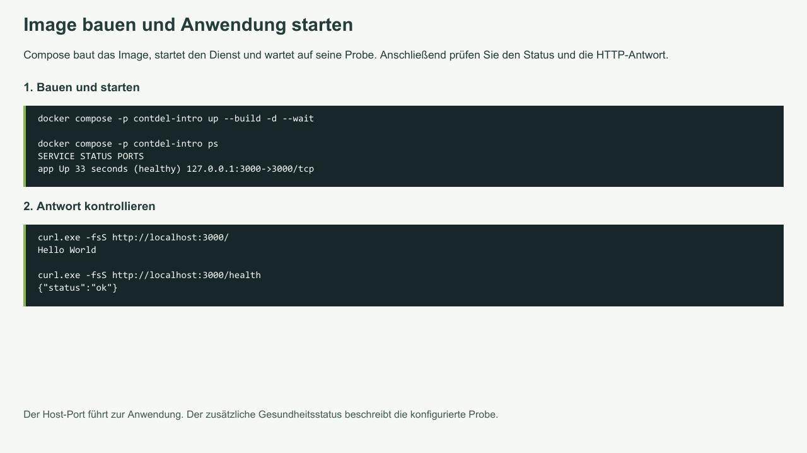

# Containerization · Continuous Delivery

Ein grüner Build liefert ein geprüftes Artefakt. Auf einem anderen Rechner fehlen aber möglicherweise die Laufzeit, Bibliotheken oder Einstellungen. Hier verpacken Sie eine kleine Anwendung mit ihrer Laufzeit und verfolgen den Weg vom Dockerfile bis zum antwortenden Prozess.

**Unterricht am 16.11.:** KAIT-Intro 14:15 bis 14:30, anschließend Containerization bis 16:30. Beginnen Sie mit [Installation und Funktionsprüfung](docker-00-install/README.md), dann [01: erster Container](docker-01-firststeps/README.md) und [02: Images und Cache](docker-02-images/README.md). Beide Übungen verwenden dieselbe Anwendung. Der [Arbeitsauftrag für Lesson 05](lessons/lesson-05/ARBEITSAUFTRAG.md) nennt Zeiten, Mindestnachweise und Anti-Patterns. 03 bis 06 sind vorbereitete Vertiefungen für den 24.11.; 07 ist eine kurze optionale Demonstration.

## Beispiele und Lernfolge

| Pfad | Was Sie praktisch tun | Was gegenüber dem vorherigen Schritt dazukommt | Einsatz |
|---|---|---|---|
| [00 · Installation](docker-00-install/README.md) | Docker auf Windows, macOS oder Linux einrichten; Client, Engine und Compose prüfen. | Ein installiertes CLI ist noch keine laufende Engine. | Vorbereitung |
| [01 · First Steps](docker-01-firststeps/README.md) | Einen kleinen HTTP-Dienst bauen, starten, prüfen und entfernen. | Dockerfile, Image, Instanz und Portzuordnung werden an drei Endpunkten sichtbar. | 16.11., Pflicht |
| [02 · Images und Cache](docker-02-images/README.md) | Unverändert bauen, nur den Gruß ändern und zwei Image-Stände vergleichen. | Das Build-Log erklärt Cache-Treffer; ein Neubuild ersetzt keinen laufenden Container. Kein zweites Projekt nötig. | 16.11., Pflicht |
| [03 · Netzwerk und Volume](docker-03-network-volume/README.md) | Web-Service und Counter gemeinsam starten, Verbindung unterbrechen und Daten erhalten. | Zwei eigene Dockerfiles, Service-DNS und ein benanntes Datenvolume. | Brücke zu 24.11. |
| [04 · Compose mit WordPress](docker-04-compose/README.md) | WordPress mit MySQL einrichten, Beitrag/Upload nach Neuerstellung wiederfinden. | Bereits gepflegte Anwendungsimages, Datenbank-Readiness und zwei getrennte Volumes. Das eigene Dockerfile ergänzt eine PHP-Einstellung. | 24.11., Kern |
| [05 · Mehrere Services](docker-05-compose-multi-container/README.md) | Über einen Proxy dieselbe Adresse zu zwei Diensten verfolgen. | Nginx-Routing, interne Service-Ports und bewusst nur ein veröffentlichter Einstieg. | Vertiefung |
| [06 · Laufzeitkonfiguration](docker-06-environment-variables/README.md) | Gruß und Port verändern, Container neu erstellen, Image-ID vergleichen. | Eigenes lauffähiges Setup; `.env`, Compose-Interpolation und Prozessumgebung werden getrennt. | Ergänzung zum Release Board |
| [07 · Geprüftes Runtime-Image](docker-07-tested-image/README.md) | Test- und Runtime-Stage verbinden; fehlgeschlagenen Build und Runtime-Inhalt prüfen. | Nur die Anwendung gelangt aus der geprüften Stage in das finale Image. | Optionale Demo |
| [08 · Healthcheck](docker-08-healthcheck/README.md) | Bereitschaft und lokale Funktionsfähigkeit trennen, Fehler auslösen und Erholung beobachten. | Health-Status, Zeitparameter, Compose-Override und Restart-Policy; grüner Status trotz falscher Fachantwort. | Freiwillige Vertiefung nach 01/02 |
| [09 · Logging](docker-09-logging/README.md) | Request-Logs lesen; optional einen Eintrag an Fluentd senden. | Begrenzte lokale Logs und ein ausdrücklich separater Collector-Versuch. | Zusatzmaterial |

Die kleinen Node-Beispiele sind eigenständig ausführbare Lernstände, keine gemeinsame Anwendung mit versteckten Querverweisen. 02 ist absichtlich eine Anleitung zum Projekt aus 01. Standarddienste wie MySQL laufen direkt aus dem offiziellen Image; ein leeres Dockerfile würde dort nichts erklären.

## Schnellstart vom Repository-Hauptordner

Für einen ersten Funktionstest startet die `compose.yaml` im Hauptordner den geprüften Dienst aus 07. Das ist eine Abkürzung zur laufenden Anwendung. Für das schrittweise Kennenlernen am 16.11. verwenden Sie anschließend die einzelnen Docker-Befehle aus 01.

1. **Engine und Arbeitsverzeichnis prüfen.** `docker version` muss Client und Server zeigen. Im aktuellen Ordner muss `compose.yaml` liegen.

2. **Bauen und starten.** Der erste Build lädt das Basisimage und benötigt Internetzugriff.

   ```powershell
   docker compose config --quiet
   docker compose up --build -d --wait
   docker compose ps
   curl.exe -fsS http://localhost:3000/
   curl.exe -fsS http://localhost:3000/health
   ```

   Linux/macOS verwendet `curl` statt `curl.exe`. Erwartet werden `Hello World` und `{"status":"ok"}`. Lesen Sie beim ersten Build auch die drei ausgeführten Tests. Ein späteres `CACHED` bei `RUN npm test` verwendet das frühere Ergebnis.

   

   `CACHED` kennzeichnet wiederverwendete Build-Schritte. Danach zeigt `ps` den laufenden Dienst und `curl` seine HTTP-Antwort.

3. **Im Browser prüfen und Logs zuordnen.** Öffnen Sie [localhost:3000](http://localhost:3000) und danach `/health`. Rufen Sie anschließend `docker compose logs --tail 20 app` auf. Die Endpunkte gehören zur Anwendung; Docker erzeugt sie nicht automatisch.

4. **Gezielt beenden.** `docker compose stop` hält die vorhandenen Container an; `docker compose start` startet diese Instanzen erneut. `docker compose down` entfernt Container und Projektnetz. Bei diesem zustandslosen Dienst gibt es keine Datenmigration und kein persistentes Volume. In 03/04 bleiben benannte Volumes bei `down` erhalten; `down --volumes` wäre dort ein bewusster Datenreset.

## Ports und typische Startprobleme

| Einstieg | Host-Port | Container-Port |
|---|---|---|
| Hauptordner | 3000 | 3000 |
| 01, CLI oder optional Compose | 8300 | 3000 |
| 02, veränderter zweiter Stand | 8301 | 3000 |
| 03 | 8303 | 3000 im Web-Service |
| 04 | 8000 | 80 in WordPress |
| 05 | 8080 | 80 im Proxy |
| 05, optionaler Node-Direktstart | 8305 | 3000 |
| 06 | 8306, konfigurierbar | 3000, konfigurierbar |
| 07 | 8307 | 3000 |
| Logging | 3001 | 3000 |

Alle veröffentlichten Übungsports sind an `127.0.0.1` gebunden. Die Beispiele sind damit für den lokalen Browser gedacht. Eine andere Portnummer ändern Sie auf der **Host-Seite**, nicht wahllos an beiden Seiten.

| Beobachtung | Zuerst prüfen | Geeigneter nächster Schritt |
|---|---|---|
| `Cannot connect` / kein Server | Läuft Docker Desktop bzw. die Engine? `docker context ls`, `docker version`. | Vorgesehene Engine starten und Kontext auswählen; nicht neu installieren, solange nur der Dienst fehlt. |
| `docker` nicht gefunden | Neues Terminal öffnen; unter Windows `where.exe docker`, unter macOS/Linux `command -v docker`. | PATH bzw. Installation aus 00 prüfen. Eine alte Verknüpfung kann auf eine frühere Installation zeigen. |
| Port bereits belegt | `docker ps` und die lokale Anwendung auf diesem Port. | Eigenen alten Versuch beenden oder einen anderen Host-Port wählen. Keine fremden Container stoppen. |
| `no configuration file` / Dockerfile fehlt | Ordner und `dir` bzw. `ls`. | In den für den Schritt genannten Ordner wechseln; 01 baut in `my-node-app`. |
| Registry-/Downloadfehler | Internet, Proxy, Registry-Antwort und vollständige Fehlermeldung. | Zugang prüfen und gezielt erneut versuchen. Kein Quellcodefehler daraus ableiten. |
| Container läuft, Browser antwortet nicht | `docker ps`, `docker logs`, Host-Port und Bind-Adresse. | Auf dem Host `localhost:HOSTPORT` verwenden; der Dienst im Container bindet an `0.0.0.0`. |
| `unhealthy`, Prozess läuft weiter | `docker inspect NAME --format '{{json .State.Health}}'`. | Probe und Anwendung getrennt untersuchen. Ein Health-Fehler startet bei Docker Engine allein den Container nicht neu. |
| Neue Werte fehlen / alte Antwort | Verwendete Image-ID, `MESSAGE`, Zeitpunkt der Container-Erstellung. | Nach Neubuild neu erstellen; bei Konfiguration `up` statt nur `restart`. Details in 02/06. |

## Nachschlagen und Weiterarbeiten

- [Docker-Cheatsheet](docker-01-firststeps/docker-cheatsheet.md): die wichtigsten Befehle mit kurzen Erklärungen.
- [Image weitergeben](docker-01-firststeps/share-docker.md): lokaler Export gegenüber Registry, Tag und Digest.
- [Lesson 06](lessons/lesson-06/ARBEITSAUFTRAG.md): Konfiguration, Compose, Daten und Registry am 24.11.
- [Course Guide auf localhost:3080](http://localhost:3080/#overview): lokaler Einstieg in die gesamte LV. Starten Sie dafür zuerst das benachbarte Repository course-base.

Offizielle Hilfen: [Docker-Installation](https://docs.docker.com/get-started/get-docker/), [Desktop-Fehlersuche](https://docs.docker.com/desktop/troubleshoot-and-support/troubleshoot/), [Docker CLI](https://docs.docker.com/reference/cli/docker/), [Compose CLI](https://docs.docker.com/reference/cli/docker/compose/). Quellen und Einordnung der Screenshots stehen im [Bildnachweis](assets/screenshots/README.md).
