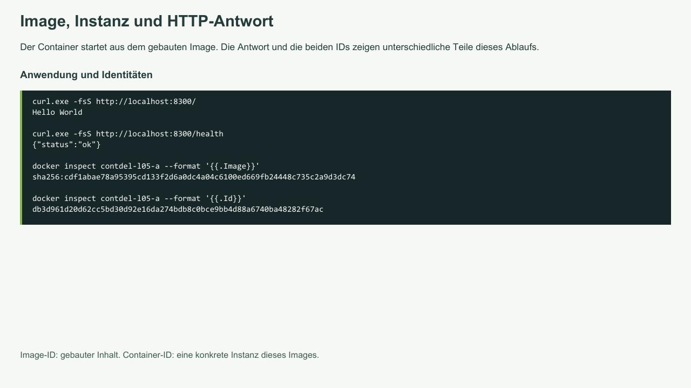

# 01 · Einen Container bauen, starten und verstehen

Sie verwenden einen kleinen HTTP-Dienst ohne externe Laufzeitpakete. Unter `/` liefert er einen Gruß, unter `/health` den Status `{"status":"ok"}`, bei unbekannten Pfaden den HTTP-Status 404. Drei Tests prüfen diese Fälle. Node.js läuft im Container; auf Ihrem Rechner benötigen Sie nur die Werkzeuge aus [00](../docker-00-install/README.md).

**Im Unterricht:** [Übung A](../lessons/lesson-05/ARBEITSAUFTRAG.md), Folien 13 bis 20. Das [Cheatsheet](docker-cheatsheet.md) bleibt als Nachschlagehilfe daneben offen.

## 1. Ausgangsdateien ansehen

Wechseln Sie vom Hauptordner nach `docker-01-firststeps/my-node-app`.

| Datei | Wozu Sie diese jetzt lesen |
|---|---|
| `app.js` | HTTP-Routen, Bind-Adresse `0.0.0.0`, Gruß aus `MESSAGE` oder Fallback. Die Funktion `createServer` kann im Test getrennt gestartet werden. |
| `test/app.test.js` | Drei echte HTTP-Aufrufe gegen einen temporären lokalen Server. Der Gruß-Test übergibt einen eigenen Wert: Er prüft nicht automatisch den später geänderten Fallback. |
| `package.json` / `package-lock.json` | `npm test` startet den eingebauten Node-Test-Runner. Die Lockdatei legt die Installationsgrundlage für `npm ci` fest, obwohl dieser Dienst keine externen Pakete benötigt. |
| `Dockerfile` | Laufzeit, kopierte Dateien, Testschritt und Startvorgaben für das Image. `RUN npm test` gehört zum Build; `CMD` startet später den Prozess. |
| `.dockerignore` | Lokale Abhängigkeiten, Git-Daten, Logs und Umgebungsdateien gelangen nicht in den Build-Kontext. |
| `compose.yaml` | Alternative Beschreibung desselben Starts, erst nach dem einzelnen `docker run`. |

## 2. Image bauen

```powershell
docker version
docker build -t contdel-first:lesson05 .
docker image inspect contdel-first:lesson05 --format '{{.Id}}'
```

Der Punkt wählt den aktuellen Ordner als Build-Kontext. `-t` vergibt den Namen mit Tag. Das Basisimage enthält Node.js; Ihr Dockerfile ergänzt Paketdefinitionen, Anwendung und Tests. Lesen Sie die drei Testergebnisse. Ein späterer Cache-Treffer führt die Tests nicht frisch aus.

## 3. Instanz starten und im Browser prüfen

```powershell
docker run -d --name contdel-l05-a -p 127.0.0.1:8300:3000 contdel-first:lesson05
docker ps
curl.exe -fsS http://localhost:8300/
curl.exe -fsS http://localhost:8300/health
docker logs --tail 10 contdel-l05-a
```

Linux/macOS verwendet `curl`. Öffnen Sie zusätzlich [localhost:8300](http://localhost:8300). `-d` startet im Hintergrund. Der Browser spricht **Host-Port 8300** an; Docker leitet an **Port 3000 im Container** weiter. `EXPOSE 3000` im Dockerfile dokumentiert den Port, veröffentlicht ihn aber nicht.



Der Prozess läuft als Benutzer `node`. Im Container bindet er an `0.0.0.0`, damit die Portweiterleitung ihn erreicht. Das ist eine andere Grenze als die bewusst lokale Veröffentlichung `127.0.0.1` auf dem Host.

## 4. Image, Instanz und Health auseinanderhalten

```powershell
docker image inspect contdel-first:lesson05 --format '{{.Id}}'
docker inspect contdel-l05-a --format '{{.Image}}'
docker inspect contdel-l05-a --format '{{.Id}}'
docker inspect contdel-l05-a --format '{{.State.Status}} / {{.State.Health.Status}}'
```

Die erste und zweite Ausgabe bezeichnen denselben Image-Inhalt. Die dritte ID bezeichnet die Containerinstanz. `running` sagt, dass der Hauptprozess läuft. `healthy` kommt bei uns von einer erfolgreichen HTTP-Probe auf `/health` innerhalb des Containers. Direkt nach dem Start kann dort noch `starting` stehen; die Probe läuft alle fünf Sekunden.

Die API-Route ist Anwendungscode. Die Dockerfile-Anweisung `HEALTHCHECK` führt den prüfenden Befehl aus und ergänzt den Containerstatus. Ein grünes `/health` beweist nicht den richtigen Gruß auf `/`. Ein Health-Fehler allein startet den Container bei Docker Engine auch nicht automatisch neu.

## 5. Stoppen, erneut starten und entfernen

```powershell
docker stop contdel-l05-a
docker ps -a --filter name=contdel-l05-a
docker start contdel-l05-a
curl.exe -fsS http://localhost:8300/
docker stop contdel-l05-a
docker rm contdel-l05-a
docker image inspect contdel-first:lesson05 --format '{{.Id}}'
```

Stoppen lässt die Instanz bestehen; Entfernen löscht diese Instanz. Das Image bleibt vorhanden. Es gibt in diesem Beispiel keine persistenten Anwendungsdaten, Volumes oder Migrationen. Verwenden Sie die Namen nur für die eigenen Übungscontainer.

## 6. Optional: denselben Start mit Compose beschreiben

Nach dem Entfernen des CLI-Containers ist Port 8300 wieder frei:

```powershell
docker compose config --quiet
docker compose up --build -d --wait
docker compose ps
docker compose logs --tail 10 app
docker compose down
```

`build: .` verweist auf dasselbe Dockerfile, `ports` entspricht der vorherigen Zuordnung. `environment` setzt `MESSAGE` ausdrücklich; dieser Wert überlagert den Fallback in `app.js`. `read_only`, `cap_drop` und `no-new-privileges` begrenzen Schreibmöglichkeiten und Rechte. Für den Cache-Versuch bleiben Sie beim CLI-Start ohne `MESSAGE`.

## 7. Ergebnis und nächster Schritt

Sie sollten jetzt Portweg, drei IDs/Referenzen und Stoppen gegenüber Entfernen erklären können. In [02](../docker-02-images/README.md) ändern Sie **dieselbe Anwendung** und beobachten den Build-Cache. [07](../docker-07-tested-image/README.md) trennt später Tests und Runtime-Inhalt. [Image weitergeben](share-docker.md) ist die Ergänzung zur Registry-Einheit.

[Docker run](https://docs.docker.com/reference/cli/docker/container/run/) · [Dockerfile](https://docs.docker.com/reference/dockerfile/) · [Veröffentlichte Ports](https://docs.docker.com/engine/network/port-publishing/).
