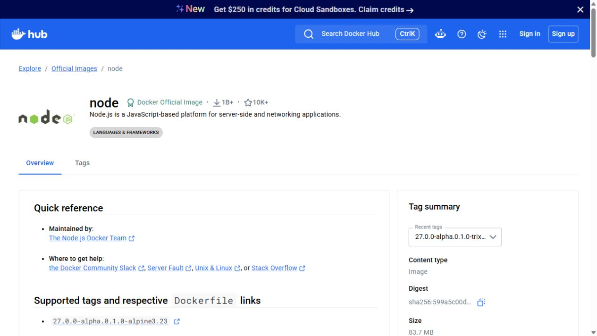

# Ein gebautes Image weitergeben

Ein Dockerfile ist eine Bauanleitung. Möchten Sie dagegen **genau den gebauten Stand** weitergeben, übertragen Sie das Image. Hier sehen Sie lokalen Export und Registry gegenübergestellt. Im Unterricht am 24.11. verwenden Sie den zugewiesenen Registry-Pfad aus dem [Arbeitsauftrag](../lessons/lesson-06/ARBEITSAUFTRAG.md); ein eigener öffentlicher Upload ist für den Einstieg am 16.11. nicht nötig.

## 1. Image und Ziel prüfen

```powershell
docker image inspect contdel-first:lesson05 --format '{{.Id}}'
docker image ls
```

Notieren Sie Inhalt, Tag und Architektur. Ein lokaler Tag wie `lesson05` ist keine unveränderliche Identität. Das empfangende Gerät benötigt eine passende Plattform; ein lokal gebautes Einzelplattform-Image wird durch den Upload nicht automatisch zu einem Multi-Arch-Image.

## 2. Optional ohne Registry übertragen

```powershell
docker save -o contdel-first.tar contdel-first:lesson05
docker load -i contdel-first.tar
```

`save` schreibt das Image als Archiv, `load` wird auf dem empfangenden Rechner ausgeführt. Das Archiv ist ein generiertes Build-Artefakt und wird durch `.gitignore` ausgenommen. Es enthält keine separat verwalteten Volumes und ist daher kein Backup der Daten aus 03/04.

## 3. Eine Registry als Ablage verstehen

Eine Registry speichert Images in Repositories mit Tags und Digests. Docker Hub ist eine mögliche Registry; die LV verwendet je nach Auftrag GitLab oder einen zugewiesenen Registry-Pfad. Die öffentliche [Node-Image-Seite](https://hub.docker.com/_/node) zeigt beispielsweise Dokumentation, Tags und unterstützte Plattformen.



Das Bild erläutert die Registry-Oberfläche, es zeigt keinen Upload eines eigenen Kursimages. Das lokal verwendete Basisimage steht im Dockerfile, nicht im README-Screenshot.

## 4. Eigenen Stand taggen, pushen und anhand des Digests beziehen

Die folgenden Werte sind Platzhalter. Ersetzen Sie **REGISTRY**, **PROJECT** und **OWN_TAG** vollständig durch das zugewiesene Ziel. Führen Sie diesen Schritt nur im eigenen freigegebenen Repository aus.

```text
docker tag contdel-first:lesson05 REGISTRY/PROJECT/app:OWN_TAG
docker login REGISTRY
docker push REGISTRY/PROJECT/app:OWN_TAG
docker pull REGISTRY/PROJECT/app@sha256:DIGEST
```

Notieren Sie den nach dem Push/Pull gemeldeten Digest und verwenden Sie die vollständige Referenz. Ein neuer Tag allein erzeugt keinen neuen Image-Inhalt. Melden Sie sich über den Login-Dialog bzw. `--password-stdin` an, ohne Token in Befehlsbeispiele oder Nachweise zu schreiben. Prüfen Sie vor einem Upload, wer das Ziel lesen kann.

## 5. Auf dem empfangenden Rechner starten

Starten Sie den gezogenen Stand ohne Neubuild, z. B. mit `docker run -d --name contdel-received -p 127.0.0.1:8300:3000 REGISTRY/PROJECT/app@sha256:DIGEST`. Prüfen Sie `/`, `/health` und die verwendete Image-Identität. Stoppen und entfernen Sie anschließend nur diese eigene Instanz.

[Image save](https://docs.docker.com/reference/cli/docker/image/save/) · [Image load](https://docs.docker.com/reference/cli/docker/image/load/) · [Image push](https://docs.docker.com/reference/cli/docker/image/push/) · [Docker Hub Repositories](https://docs.docker.com/docker-hub/repos/).
