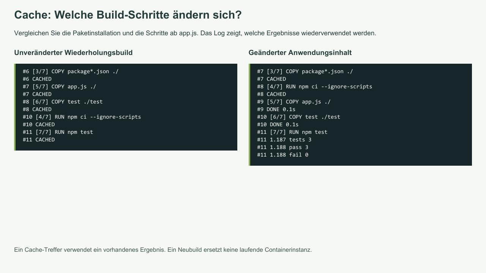

# 02 · Images, Schichten und Build-Cache

Sie bleiben bei der Anwendung aus 01. Hier gibt es deshalb kein zweites Dockerfile. Bauen Sie in `docker-01-firststeps/my-node-app`; lesen Sie diese Anleitung daneben. Im Unterricht gehört dies zu Folien 22 bis 32 und [Übung B](../lessons/lesson-05/ARBEITSAUFTRAG.md).

## 1. Die Reihenfolge lesen

Im Dockerfile stehen zuerst die Paketdateien und `RUN npm ci`, danach `app.js`, Tests und `RUN npm test`. Damit muss eine Änderung am Gruß nicht automatisch eine neue Paketinstallation auslösen. `.dockerignore` begrenzt den Kontext; eine Änderung an ausgeschlossenen lokalen Logs ist keine neue Anwendungseingabe.

| Änderung | Erwartung bei vorhandenem passendem Cache |
|---|---|
| Keine | Unveränderte Schritte können `CACHED` sein, auch der Testschritt. |
| Nur `app.js` | Paketinstallation kann wiederverwendet werden; ab der Anwendung wird neu ausgewertet. |
| Nur ein Test | Anwendung davor bleibt wiederverwendbar; Testdateien und nachfolgende Prüfung ändern sich. |
| Paketdateien | Installation und der folgende Pfad müssen erneut ausgewertet werden. |

Wenn genau der geänderte Stand früher bereits gebaut wurde, kann auch dieser bis zum Testschritt im Cache liegen. Das ist ein gültiger Treffer auf frühere Eingaben. Für einen neuen Vergleich können Sie zusätzlich eine einmalige Kommentarzeile in `app.js` ergänzen; halten Sie diese zusätzliche Eingabeänderung fest. Paketdateien bleiben dabei unverändert.

Der tatsächliche Build-Log zählt. Ein fehlender lokaler Cache, ein anderes Basisimage oder geänderte Build-Argumente verändern die Beobachtung.

## 2. Unverändert zweimal bauen

```powershell
docker build --progress=plain -t contdel-first:lesson05 .
docker build --progress=plain -t contdel-first:lesson05 .
```

Markieren Sie `CACHED` bei `RUN npm test`. Es bedeutet ein wiederverwendetes erfolgreiches Ergebnis, keine neue Testausführung. Für einen gezielt frischen Testlauf können Sie später mit `--no-cache` bauen; verwenden Sie das nicht im eigentlichen Cache-Vergleich.



Vergleichen Sie Paketinstallation, kopierte Anwendungsdatei und Testschritt. Die Dockerfile-Schritte wie `[4/7]` helfen bei der Zuordnung; Cache-Meldungen können im Log versetzt erscheinen.

## 3. Zwei Image-Stände nebeneinander ausführen

Erstellen Sie gegebenenfalls den in Übung A entfernten Ausgangscontainer neu:

```powershell
docker run -d --name contdel-l05-a -p 127.0.0.1:8300:3000 contdel-first:lesson05
```

Ändern Sie nur den Fallback in `app.js` von `Hello World` auf `Hello Container`. Lassen Sie Tests und Paketdateien unverändert. **Keine Variable `MESSAGE` setzen**; sie würde den Fallback verdecken.

```powershell
docker build --progress=plain -t contdel-first:changed .
docker run -d --name contdel-l05-b -p 127.0.0.1:8301:3000 contdel-first:changed
curl.exe -fsS http://localhost:8300/
curl.exe -fsS http://localhost:8301/
curl.exe -fsS http://localhost:8301/health
docker inspect contdel-l05-a --format '{{.Image}}'
docker inspect contdel-l05-b --format '{{.Image}}'
```

Der alte Container liefert weiterhin `Hello World`, der neue `Hello Container`. Beide können gesund sein. Ein Neubuild erzeugt Image-Inhalt; er tauscht keine Instanz aus. `docker history contdel-first:changed` erklärt den Image-Aufbau, aber nicht die Cache-Treffer des letzten Builds. Dafür brauchen Sie das Build-Log.

## 4. Den fehlgeschlagenen Build richtig deuten

Ändern Sie in einer eigenen Übungskopie die erwartete Antwort für `/missing` von 404 auf 418. Bauen Sie erneut und lesen Sie sofort den Exitcode. Der erforderliche Test muss scheitern, obwohl ein älteres Image oder ein älterer Container weiter existieren kann. Stellen Sie die Assertion und den ursprünglichen Gruß danach wieder her. Die genauen Befehle und Mindestnachweise stehen im [Arbeitsauftrag](../lessons/lesson-05/ARBEITSAUFTRAG.md).

## 5. Aufräumen und Grenze benennen

Stoppen und entfernen Sie gezielt `contdel-l05-a` und `contdel-l05-b`. Halten Sie Vorhersage, erste geänderte Build-Eingabe, echte Cache-Beobachtung und beide Antworten fest. Persistente Daten gibt es hier nicht. In [03](../docker-03-network-volume/README.md) kommt ein Volume hinzu; [07](../docker-07-tested-image/README.md) zeigt eine geprüfte Multi-Stage-Runtime.

[Cache invalidation](https://docs.docker.com/build/cache/invalidation/) · [Cache optimieren](https://docs.docker.com/build/cache/optimize/) · [Image-Historie](https://docs.docker.com/reference/cli/docker/image/history/).
