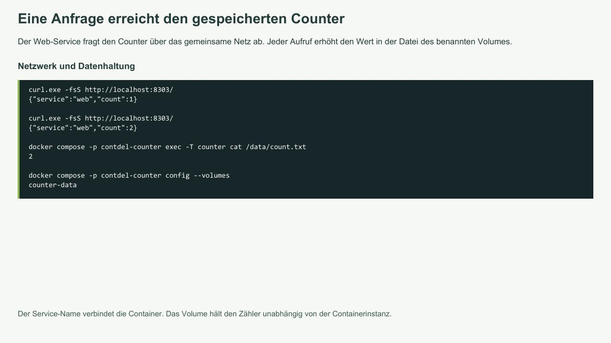

# 03 · Zwei Services und ein Volume

In 01 lief ein zustandsloser Prozess. Jetzt fragt ein Web-Service einen zweiten Service ab, der einen Zähler speichert. Das kleine Setup zeigt **Service-DNS**, **Container-Port** und **persistente Daten**, bevor Sie dieselben Grenzen in WordPress wiederfinden. Dies ist eine vorbereitete Brücke für Lesson 06 am 24.11., keine zusätzliche Pflichtaufgabe am 16.11.

```text
Browser :8303 -> web:3000 -> counter:3000 -> counter-data:/data/count.txt
                Host-Port   nur im Netz     benanntes Volume
```

## 1. Was gegenüber 01 neu ist

| Datei | Neue Entscheidung |
|---|---|
| `compose.yaml` | Zwei Services im Netz `lab`. Nur `web` veröffentlicht einen Host-Port. `COUNTER_URL` nutzt den Service-Namen `counter`. |
| `web/app.js` | Ruft den Counter mit Zeitlimit auf. Bei dessen Ausfall liefert `/` den Status 503; `/health` prüft weiterhin nur den Web-Prozess. |
| `counter/app.js` | Erhöht den Zähler pro Aufruf von `/` und schreibt nach `/data/count.txt`. Health-Aufrufe erhöhen ihn nicht. |
| Zwei `Dockerfile`-Dateien | Je eigener Prozess ein eigenes Image. Beide führen die Tests aus und laufen als `node`. Der Counter bereitet `/data` mit passenden Rechten vor. |
| `*/test/app.test.js` | Prüfen Weitergabe, Fehlerfall und Wiederverwendung des Datenverzeichnisses. Sie ersetzen den folgenden echten Netzwerk-/Volume-Test nicht. |

Das Volume wird nach `/data` gemountet; der übrige Container ist schreibgeschützt. Es gibt keine Datenbank und keine Migration, sondern absichtlich nur eine kleine Datei. Das ist kein Beispiel für einen produktiven verteilten Zähler.

## 2. Bauen und den Weg verfolgen

Im Ordner `docker-03-network-volume`:

```powershell
docker compose config --quiet
docker compose up --build -d --wait
docker compose ps
curl.exe -fsS http://localhost:8303/
curl.exe -fsS http://localhost:8303/
docker compose exec web node -e "require('node:dns').lookup('counter',console.log)"
docker compose exec counter cat /data/count.txt
```

Die Antwort enthält `service: web` und einen steigenden `count`. Ein frisches Volume beginnt beim ersten fachlichen Aufruf mit 1; ein vorhandenes Volume setzt den alten Stand fort. Im Web-Container bezeichnet `localhost` den Web-Container selbst. `counter:3000` ist dagegen im gemeinsamen Compose-Netz erreichbar. Seine wechselnde IP wird nicht in die Konfiguration eingetragen.



## 3. Eine Abhängigkeit gezielt stoppen

```powershell
docker compose stop counter
curl.exe -i http://localhost:8303/
curl.exe -fsS http://localhost:8303/health
docker compose ps
docker compose start counter
```

Erwartet: `/` liefert 503, das lokale `/health` kann weiterhin 200 liefern. `depends_on: condition: service_healthy` hilft bei der Startreihenfolge; es repariert keinen späteren Ausfall. Die Anwendung braucht ihren eigenen Umgang mit einer nicht erreichbaren Abhängigkeit. Nach dem Counter-Start rufen Sie `/` erneut auf.

## 4. Persistenz nach Neuerstellung prüfen

Notieren Sie den letzten Zählerwert und den Projektnamen aus `docker compose ls`.

```powershell
docker compose down
docker compose up -d --no-build --wait
curl.exe -fsS http://localhost:8303/
docker compose config --volumes
```

Der Zähler steigt vom gespeicherten Wert aus weiter. Der logische Volume-Name lautet `counter-data`; Docker stellt ihm normalerweise den Compose-Projektnamen voran. Ein anderer Projektname erzeugt einen anderen Datenbestand. Die Container können ersetzt werden, während das Volume erhalten bleibt.

## 5. Abschluss und Übertragung

`docker compose down` beendet das Labor und erhält das Volume. Nur für einen **bewusst gewünschten Reset der eigenen entbehrlichen Zählerdaten** verwenden Sie im selben Projekt `docker compose down --volumes`. Keine globalen Löschbefehle.

Zeigen Sie Netzweg, den 503-/200-Vergleich und einen weitergezählten Wert nach Neuerstellung. In [04](../docker-04-compose/README.md) übernimmt MySQL die Datenhaltung. Auch dort ist ein überlebendes Volume noch kein Backup; das ist der Fall AP18 aus [Lesson 06](../lessons/lesson-06/anti-patterns/README.md).

[Compose-Netzwerke](https://docs.docker.com/compose/how-tos/networking/) · [Startreihenfolge](https://docs.docker.com/compose/how-tos/startup-order/) · [Volumes](https://docs.docker.com/engine/storage/volumes/).
