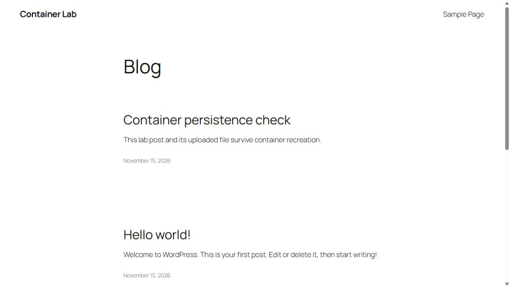

# 04 · WordPress mit MySQL und Compose

Sie wenden die Grenzen aus 03 auf eine bestehende Anwendung an. WordPress spricht über den Service-Namen `db` mit MySQL. Der Browser erreicht nur WordPress auf Host-Port 8000. Beitrag und Upload liegen in zwei verschiedenen benannten Volumes. Dies ist das Datenlabor aus [Lesson 06 am 24.11.](../lessons/lesson-06/ARBEITSAUFTRAG.md), Fachfolien 17 bis 21.

## Compose auf andere Anwendungen übertragen

WordPress ist hier ein anschauliches Beispiel für mehrere zusammenarbeitende Dienste. Sie können denselben Aufbau etwa für eine API mit Datenbank, eine Webanwendung mit Cache oder einen Webserver vor einem eigenen Dienst verwenden.

Jeder eigenständig betriebene Dienst erhält seinen eigenen Container und seine passende Laufzeit: hier WordPress mit Apache/PHP sowie MySQL. Dadurch lassen sich Image-Versionen getrennt festlegen, Abhängigkeiten übersichtlich halten und einzelne Dienste gezielt ersetzen. Compose beschreibt ihren gemeinsamen Start, die Netzverbindungen und die Datenhaltung.

Die Trennung richtet sich nach den Aufgaben der Dienste. Zusammengehörige Prozesse wie Apache-Worker können innerhalb desselben Containers laufen. Prüfen Sie beim Austausch eines Images weiterhin Schnittstellen und Datenkompatibilität; eine andere MySQL-Hauptversion kann beispielsweise eine Datenmigration erfordern. Die benannten Volumes halten Daten unabhängig von der Containerinstanz.

## 1. Dateien und Unterschiede zu 03

| Datei / Einstellung | Warum sie hier gebraucht wird |
|---|---|
| `compose.yaml` | Verbindet WordPress und MySQL im Netz `wordpress`. Die Datenbank hat keinen veröffentlichten Host-Port. |
| `wordpress/Dockerfile` | Verwendet das fest versionierte offizielle WordPress-Image und ergänzt die eigene PHP-Konfiguration sowie eine HTTP-/PHP-Bereitschaftsprobe. MySQL bleibt als unveränderter Standarddienst direkt beim offiziellen Image. |
| `wordpress/uploads.ini` | Erlaubt 8 MB pro Upload bei 10 MB für den gesamten Request. Die Differenz ist für weitere Formulardaten vorgesehen. Das ist eine Image-Einstellung und benötigt nach Änderung einen Build. |
| `.env.example` | Benennt zwei erforderliche lokale Übungspasswörter. Die echte `.env` bleibt unversioniert. [Details zur Konfiguration](config-env.md). |
| `depends_on` / `healthcheck` | WordPress startet erst nach erfolgreicher MySQL-Probe. Die Probe allein bestätigt weder WordPress-Einrichtung noch korrekte Anwendungszugangsdaten. |
| `mysql-volume` / `wordpress-volume` | Datenbankinhalt bzw. WordPress-Dateien, einschließlich Uploads. Beide werden beim normalen `down` behalten. |

Die MySQL-Probe verwendet ausdrücklich TCP (`--protocol=tcp`, `127.0.0.1`). Während der Erstinitialisierung kann ein temporärer MySQL-Prozess bereits über den lokalen Socket antworten, obwohl der reguläre Server noch nicht bereit ist. Die TCP-Probe wartet auf dessen Netzwerkstart. Auch sie beweist allein keine erfolgreiche Anmeldung mit den Anwendungsdaten.

Die WordPress-Probe ruft intern `/wp-includes/version.php` ab. Die mitgelieferte Datei liefert bei funktionierendem Apache/PHP HTTP 200, ohne eine vollständige WordPress-Seite oder Datenbankanmeldung zu prüfen. So wartet `--wait` auch auf den Webdienst. Beitrag und Upload prüfen Sie weiterhin separat.

## 2. Ein eigenes frisches Labor vorbereiten

Wechseln Sie in `docker-04-compose`. Kopieren Sie `.env.example` nach `.env`, sofern dort nicht bereits Ihre eigenen Werte stehen: PowerShell `Copy-Item .env.example .env`, Linux/macOS `cp .env.example .env`. Tragen Sie zwei **nur für das lokale Labor** gewählte Passwörter ein. Keine echten Dienstzugänge verwenden.

Verwenden Sie für alle Befehle denselben Projektnamen, hier `contdel-wp-lab`:

```powershell
docker compose -p contdel-wp-lab config --quiet
docker compose -p contdel-wp-lab up --build -d --wait
docker compose -p contdel-wp-lab ps
docker compose -p contdel-wp-lab logs --tail 20 db wordpress
```

Der erste Start initialisiert Datenbank und WordPress-Dateien. Geben Sie diesem Schritt Zeit und lesen Sie bei einem Fehler die Logs, statt sofort Daten zu löschen. Falls Port 8000 belegt ist, passen Sie nur die Host-Seite in Ihrer Arbeitskopie an und verwenden Sie die neue Adresse.

## 3. WordPress einrichten und Daten zuordnen

Öffnen Sie [localhost:8000](http://localhost:8000). Richten Sie ausschließlich die eigene lokale Testsite ein. Verwenden Sie erfundene Inhalte und eine Testadresse, beispielsweise `student@example.test`. Legen Sie einen Beitrag sowie einen kleinen Datei-Upload an. Merken Sie sich die lokalen Anmeldedaten; diese gehören nicht in Git oder den Ergebnisnachweis.



Prüfen Sie die Image-Einstellung ohne eine zusätzliche öffentliche PHP-Infoseite:

```powershell
docker compose -p contdel-wp-lab exec wordpress php -r "echo ini_get('upload_max_filesize'), PHP_EOL, ini_get('post_max_size'), PHP_EOL;"
docker compose -p contdel-wp-lab config --volumes
```

Die Ausgabe der PHP-Grenzen soll `8M` und `10M` sein. Zeichnen Sie Browser → Host:8000 → WordPress:80 → db:3306. Das `localhost` des WordPress-Containers ist nicht der Datenbank-Container.

## 4. Container ersetzen, Inhalte erhalten

Notieren Sie Projektnamen, Beitrag und hochgeladene Datei. Danach:

```powershell
docker compose -p contdel-wp-lab down
docker compose -p contdel-wp-lab up -d --no-build --wait
```

Melden Sie sich erneut an und prüfen Sie Beitrag **und** Upload. Die Datenbankeinträge liegen in `mysql-volume`, die Datei in `wordpress-volume`. Ein Inhalt im weiterhin erreichbaren Browsercache genügt nicht: Laden Sie die Seite neu und öffnen Sie den Beitrag bzw. Upload erneut.

Der Nachweis zeigt Persistenz bei Container-Neuerstellung, kein Backup. Löschen, Host-Ausfall und fehlerhafte Änderungen können weiterhin beide Datenbestände betreffen. Für AP18 braucht es zusätzlich eine unabhängige Sicherung und einen geprüften Restore in einem getrennten Labor.

## 5. Stop, Reset und typische Fehler

- Anhalten: `docker compose -p contdel-wp-lab stop`; dieselben Instanzen fortsetzen: `start`.
- Container entfernen und Daten behalten: `docker compose -p contdel-wp-lab down`.
- **Kein `down --volumes` während der Persistenzübung.** Es löscht beide Labor-Datenbestände und wäre nur ein absichtlicher vollständiger Reset.
- Geänderte MySQL-Passwortwerte initialisieren vorhandene Konten nicht neu. Entweder kontrolliert in MySQL ändern oder ausschließlich entbehrliche eigene Labordaten bewusst neu initialisieren.
- WordPress verwaltet seine Schemainitialisierung. Vor einem späteren Image-/Datenbank-Upgrade sind Kompatibilität, Backup und Restore gesondert zu prüfen.

[WordPress-Image](https://hub.docker.com/_/wordpress) · [MySQL-Image](https://hub.docker.com/_/mysql) · [Compose-Startreihenfolge](https://docs.docker.com/compose/how-tos/startup-order/) · [Volumes](https://docs.docker.com/engine/storage/volumes/).

[MySQL-Startskript](https://github.com/docker-library/mysql/blob/master/8.4/docker-entrypoint.sh) · [Bedeutung von mysqladmin ping](https://dev.mysql.com/doc/refman/8.4/en/mysqladmin.html).
