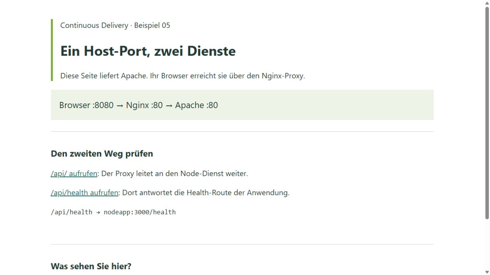

# 05 · Ein Einstieg, mehrere Services

In 04 wurde WordPress direkt veröffentlicht. Jetzt steht ein Nginx-Proxy vor zwei Diensten. Nur der Proxy veröffentlicht einen Host-Port; er leitet anhand des Pfads intern weiter. Dies ist eine Vertiefung nach den Pflichtnachweisen aus Lesson 06.

```text
Browser :8080 -> proxy:80 -> /api/ -> nodeapp:3000
                         -> /     -> apache:80
```

## 1. Dateien und neue Einstellungen

| Datei | Gegenüber 04 neu / worauf achten? |
|---|---|
| `compose.yaml` | Drei Services im Netz `frontend`. Nur `proxy` hat `ports`. Seine Abhängigkeiten warten auf die lokalen Proben der beiden Dienste. |
| `nginx.conf` | Pfadabhängiges Routing. Bei `/api/` entfernt der abschließende Slash in `proxy_pass http://nodeapp:3000/` das Präfix: `/api/health` wird zu `/health`. |
| `nodeapp/Dockerfile`, `app.js`, `test/` | Bekannter Grußdienst mit drei Tests. Hier wird er intern statt direkt über einen Host-Port angesprochen. |
| `nodeapp/compose.yaml` | Optionaler Direktstart des Node-Dienstes auf 8305 ohne Proxy. Eigener Image-Name, damit dieser Versuch das Runtime-Image aus 07 nicht umtaggt. |
| `public-html/index.html` | Kleine statische Seite im Apache-Service. Ein Read-only-Bind-Mount macht lokale Änderungen ohne Image-Build sichtbar. Das ist bewusst ein Entwicklungsbeispiel. |
| `compose.database.yaml` | Getrennte optionale Datenbank, **nicht** Teil des normalen Starts. Keiner der beiden Dienste verwendet sie bereits. |

Nginx und Apache verwenden hier unveränderte fest versionierte Standardimages. Das eigene Node-Image besitzt sein Dockerfile. Ein Dockerfile für jeden unveränderten Standarddienst würde keine zusätzliche Konfiguration erklären.

## 2. Starten und Routen prüfen

Im Ordner `docker-05-compose-multi-container`:

```powershell
docker compose config --quiet
docker compose up --build -d --wait
docker compose ps
curl.exe -fsS http://localhost:8080/
curl.exe -fsS http://localhost:8080/api/
curl.exe -fsS http://localhost:8080/api/health
curl.exe -i http://localhost:8080/api/missing
```

Erwartet: statische HTML-Seite, Gruß, Health-JSON und zuletzt HTTP 404. Öffnen Sie [localhost:8080](http://localhost:8080). Die Node- und Apache-Ports werden nicht zusätzlich veröffentlicht.



## 3. Einen Request vollständig verfolgen

Rufen Sie `/api/health` auf und lesen Sie `docker compose logs --tail 20 proxy nodeapp`. Der Node-Log enthält `/health`, weil der Proxy das Präfix entfernt. Prüfen Sie mit `docker compose exec proxy nginx -t` die Syntax. Nach einer Änderung an `nginx.conf` laden Sie die Konfiguration durch `docker compose restart proxy` neu; für diesen Bind-Mount ist kein Image-Neubuild nötig.

Stoppen Sie gezielt `nodeapp`. `/api/` liefert nun je nach Fehler 502 (Verbindung abgelehnt) oder 504 (Zeitlimit), während `/` weiterhin funktioniert. Starten Sie `nodeapp` wieder. Falls Sie den Service **neu erstellt** haben und Nginx noch eine alte Adresse verwendet, starten Sie den Proxy ebenfalls neu. Die Vorlage setzt zwei Sekunden für den Verbindungsaufbau und fünf Sekunden für das Lesen/Senden. Damit bleibt der Fehler im Unterricht zeitnah sichtbar; ein Zeitlimit repariert die Abhängigkeit nicht. Die Vorlage demonstriert statisches Proxy-Routing, keine automatische Service-Reparatur oder vollständige Hochverfügbarkeit.

`--wait` wartet bei Node und Apache auf deren Proben. Der Proxy besitzt hier keine eigene Probe und wird als laufend gewertet; seine Routen prüfen Sie deshalb ausdrücklich mit den HTTP-Aufrufen. Die lokalen Healthchecks prüfen einzelne Prozesse. Erst Ihre Route durch den Proxy prüft den gemeinsamen Weg. Eine grüne Backend-Probe beweist keine richtige Nginx-Konfiguration.

## 4. Optional: Node ohne Proxy starten

Wenn Sie die Node-Antwort gezielt ohne Routing vergleichen möchten, bleiben Sie im Ordner 05 und starten Sie die separate Datei:

```powershell
docker compose -p contdel-node-direct -f nodeapp/compose.yaml up --build -d --wait
curl.exe -fsS http://localhost:8305/
docker compose -p contdel-node-direct -f nodeapp/compose.yaml down
```

Dies startet nur den Service `app`. Nginx und Apache sind dabei nicht beteiligt. Der eigene Image-Name und Host-Port halten den Direktversuch vom Hauptstack getrennt.

## 5. Optionales Datenbank-Setup einordnen

`compose.database.yaml` enthält einen getrennten MySQL-Service im internen Netz `backend` und das Volume `mysql-data`. Ein lokaler Wert aus `.env.example` ist erforderlich. Der Start wäre `docker compose -p contdel-db-extra -f compose.database.yaml up -d --wait`. Verwenden Sie diesen Pfad nur, wenn Sie die zusätzliche Datenbank selbst untersuchen wollen; er ergänzt noch keine Datenbankfunktion in der Node-App. Der normale Proxy-Start benötigt keine `.env`. Die MySQL-Probe prüft lokale Erreichbarkeit; eine erfolgreiche Anmeldung und eine echte Anwendung-DB-Verbindung sind eigene Nachweise.

Die MySQL-Probe verwendet ausdrücklich TCP (`--protocol=tcp`, `127.0.0.1`). Während der Erstinitialisierung kann ein temporärer MySQL-Prozess bereits über den lokalen Socket antworten, obwohl der reguläre Server noch nicht bereit ist. Die TCP-Probe wartet auf dessen Netzwerkstart. Auch sie beweist allein keine erfolgreiche Anmeldung mit den Anwendungsdaten.

## 6. Beenden und Ergebnis

`docker compose down` entfernt den normalen Stack. Die HTML-Datei bleibt auf dem Host, der Node-Dienst ist zustandslos; es gibt keine Migration. Für den optionalen DB-Stack verwenden Sie beim Beenden denselben Projektnamen `-p contdel-db-extra` und `-f compose.database.yaml`; sein Volume bleibt bei `down` erhalten. Ein gewünschter Datenreset muss diesen separaten Stack ausdrücklich betreffen.

Zeigen Sie zwei unterschiedliche Antworten über denselben Host-Port, den entfernten `/api/`-Präfix und eine gezielt gestörte Route. Im [Cheatsheet](../docker-01-firststeps/docker-cheatsheet.md) stehen die häufigsten Compose-Befehle.

[Nginx proxy_pass](https://nginx.org/en/docs/http/ngx_http_proxy_module.html#proxy_pass) · [Compose-Netzwerke](https://docs.docker.com/compose/how-tos/networking/) · [Compose-Startreihenfolge](https://docs.docker.com/compose/how-tos/startup-order/).

[MySQL-Startskript](https://github.com/docker-library/mysql/blob/master/8.4/docker-entrypoint.sh) · [Bedeutung von mysqladmin ping](https://dev.mysql.com/doc/refman/8.4/en/mysqladmin.html).
