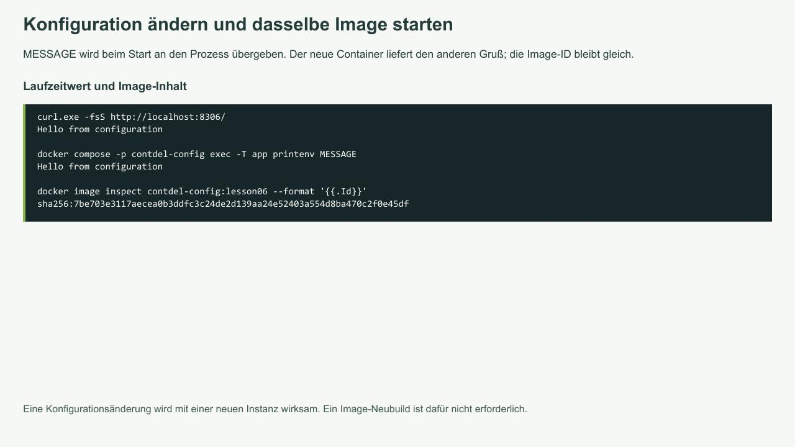

# 06 · Konfiguration ändern, Image beibehalten

In 02 änderten Sie den Quellcode und bauten ein neues Image. Jetzt bleibt die bekannte Anwendung unverändert: Nur der beim Containerstart übergebene Gruß wechselt. Dieses eigenständige Setup ergänzt die Release-Board-Aufgabe aus [Lesson 06](../lessons/lesson-06/ARBEITSAUFTRAG.md), Folien 14 bis 16 und 21.

## 1. Welche Dateien hier wichtig sind

| Datei | Unterschied zu 01 |
|---|---|
| `app.js`, Paketdateien, Tests | Derselbe kleine HTTP-Dienst als selbstständig ausführbarer Lernstand. Die drei Tests prüfen Gruß, Health und 404. |
| `Dockerfile` | Die Health-Probe verwendet jetzt ebenfalls `PORT`. Wenn der interne Port wechselt, muss die Probe denselben Prozess erreichen. |
| `compose.yaml` | `${MESSAGE}` wird zu `MESSAGE` im Prozess; `${APP_PORT}` setzt dessen `PORT` und die Zielseite der Portzuordnung. `${HOST_PORT}` betrifft nur den Host. |
| `.env.example` | Drei gewöhnliche Laborwerte für einen optionalen lokalen Start. Keine geheimen Zugangsdaten. |

`APP_PORT` und `HOST_PORT` sind Namen für die Compose-Interpolation. Der Node-Prozess liest dagegen `PORT`. Gleichnamige Shell-Werte haben für die Interpolation Vorrang vor `.env`; deshalb ändern Sie für den Vergleich genau eine Quelle.

## 2. Einmal bauen und den Ausgangsstand notieren

Wechseln Sie in `docker-06-environment-variables`. Für diesen Versuch ist keine `.env` nötig; ohne sie gelten die sichtbaren Defaults.

```powershell
docker compose config --quiet
docker compose up --build -d --wait
docker image inspect contdel-config:lesson06 --format '{{.Id}}'
curl.exe -fsS http://localhost:8306/
```

Erwartet wird `Hello World`, sofern Sie keinen eigenen Wert gesetzt haben. Notieren Sie die Image-ID. Prüfen Sie die eigene Shell und eine eventuell vorhandene `.env`, wenn stattdessen bereits ein anderer Gruß erscheint.

## 3. Gruß ändern, ausdrücklich ohne Neubuild

PowerShell:

```powershell
$env:MESSAGE = 'Hello from configuration'
docker compose up -d --no-build --force-recreate --wait
curl.exe -fsS http://localhost:8306/
docker image inspect contdel-config:lesson06 --format '{{.Id}}'
docker compose exec app printenv MESSAGE
Remove-Item Env:MESSAGE
```

Bash/zsh verwenden für den Start stattdessen:

```bash
MESSAGE='Hello from configuration' docker compose up -d --no-build --force-recreate --wait
curl -fsS http://localhost:8306/
docker image inspect contdel-config:lesson06 --format '{{.Id}}'
```



Der Gruß ändert sich, die Image-ID bleibt gleich. `--no-build` verhindert den Neubuild und `--force-recreate` macht die neue Instanz ausdrücklich sichtbar. Ein einfaches `docker compose restart` behält die vorhandene Prozessumgebung. Die Variable im Host nachträglich zu entfernen verändert den bereits laufenden Container ebenfalls nicht.

## 4. Optional: Host-Port und Prozess-Port unterscheiden

Kopieren Sie `.env.example` nach `.env`, ohne eigene Werte zu überschreiben. Setzen Sie `HOST_PORT=8316`, `APP_PORT=3100` und einen eigenen Gruß. Erstellen Sie mit `docker compose up -d --no-build --force-recreate --wait` neu. Der Browser verwendet nun `http://localhost:8316`; die Anwendung und ihre Probe verwenden intern 3100. Die Image-ID muss weiterhin identisch sein.

`EXPOSE 3000` dokumentiert weiterhin den Standardport. Es bindet den Prozess nicht an diese Zahl und verhindert daher den konfigurierten Port 3100 nicht. Würden Sie nur die Host-Seite ändern, bliebe der interne Port 3000. Würden Anwendung und Health-Probe unterschiedliche Ports verwenden, könnte der Prozess laufen und trotzdem `unhealthy` werden. Dieser Unterschied ist eine gute Fehlersuchfrage aus Lesson 05, Folie 30.

## 5. Zurücksetzen und Schlussfolgerung

Beenden Sie mit `docker compose down`. Entfernen Sie nur Ihre eigenen gesetzten Shell-Werte, und stellen Sie für den Standardstart die Werte aus `.env.example` wieder her oder verwenden Sie keine `.env`. Danach startet `up -d --no-build --wait` erneut mit der gewählten Konfiguration. Der Dienst ist zustandslos; es gibt kein Volume und keine Migration.

`ARG` ist ein Build-Parameter, `ENV` definiert Image-Defaults und `environment` ergänzt/überlagert Werte beim Start. Geheimnisse gehören nicht in Build-Argumente oder Image-Layer. Die Aufgabe verwendet absichtlich einen öffentlichen Gruß. Bezug: AP16 „Rebuild per environment“. Übertragen Sie die Beobachtung anschließend auf `APP_VERSION` im Release Board.

[Compose-Umgebungsvariablen](https://docs.docker.com/compose/how-tos/environment-variables/) · [Interpolation](https://docs.docker.com/compose/how-tos/environment-variables/variable-interpolation/) · [Compose up](https://docs.docker.com/reference/cli/docker/compose/up/).
