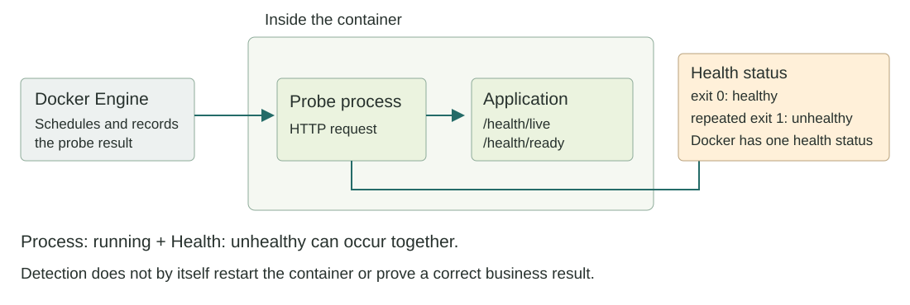

# 08 · Healthcheck: Prozess, Bereitschaft und fachliches Ergebnis

Der HTTP-Dienst aus 01 erhält zwei unterschiedliche Endpunkte und steuerbare Fehlersituationen. Sie beobachten, warum ein laufender Prozess trotzdem `unhealthy` werden kann und warum `healthy` noch keine fachlich richtige Antwort beweist. Das Beispiel ergänzt [Lesson 05, Folien 30-32](../lessons/lesson-05/README.md); es ist eine freiwillige Vertiefung nach den beiden Kernübungen.



## 1. Starten und die Anlaufphase beobachten

Voraussetzung: Docker Engine ab 25 und Docker Compose ab 2.20.2 für `start_interval`. Öffnen Sie den Beispielordner. Verwenden Sie für alle Compose-Befehle denselben Projektnamen:

```powershell
docker version
docker compose version
docker compose -p contdel-health config --quiet
docker compose -p contdel-health up --build -d
docker compose -p contdel-health ps
curl.exe -i http://localhost:8318/health/live
curl.exe -i http://localhost:8318/health/ready
```

Die Anwendung simuliert zwölf Sekunden Initialisierung. `/health/live` antwortet bereits mit HTTP 200, `/health/ready` zunächst mit 503 und danach mit 200. Der Build benötigt ebenfalls Zeit; die zwölf Sekunden beginnen erst beim Anwendungsstart. Falls die Initialisierung bei Ihrem ersten Aufruf schon abgeschlossen ist, starten Sie gezielt `docker compose -p contdel-health restart app` und beobachten Sie erneut.

```powershell
docker compose -p contdel-health ps
docker compose -p contdel-health logs --tail 20 app
```

`docker compose up --build -d --wait` wäre die bequemere Alternative, wartet aber bereits bis zur erfolgreichen Probe. Für die sichtbare Anlaufphase verwenden wir hier absichtlich noch kein `--wait`. Linux/macOS verwendet `curl` statt `curl.exe`. Bei belegtem Port ändern Sie nur den Host-Port 8318; stoppen Sie keine fremde Anwendung.

## 2. Deklaration und beobachteten Zustand zuordnen

```powershell
$appId = docker compose -p contdel-health ps -q app
docker image inspect contdel-healthcheck:lesson05 --format '{{json .Config.Healthcheck}}'
docker inspect $appId --format '{{json .Config.Healthcheck}}'
docker inspect $appId --format '{{json .State.Health}}'
docker inspect $appId --format 'Process={{.State.Status}} Restarts={{.RestartCount}}'
```

Linux/macOS setzt die Variable mit `appId=$(docker compose -p contdel-health ps -q app)` und verwendet danach ebenfalls `$appId`.

Das **Dockerfile** deklariert die lokale Probe:

```dockerfile
HEALTHCHECK --interval=5s --timeout=2s --start-period=20s --start-interval=2s --retries=3 \
  CMD ["node", "probe.js", "http://127.0.0.1:3000/health/live"]
```

**Compose überschreibt** sie für diese Instanz mit `/health/ready` und denselben Zeitwerten. Docker führt nicht beide Probes nebeneinander aus. Vergleichen Sie deshalb die Image-Konfiguration mit der Container-Konfiguration. Ein direkt aus diesem Image gestarteter Container verwendet ohne Override dagegen `/health/live`.

| Einstellung | Bedeutung | Docker-Standard bei definierter Probe | Dieses Labor |
|---|---|---|---|
| `test` / `CMD` | Befehl im Container; Exit 0 erfolgreich, Exit 1 fehlgeschlagen. Exit 2 ist reserviert. | Keine automatisch gewählte URL | Node ruft intern einen HTTP-Endpunkt auf |
| `interval` | Pause nach Abschluss einer regulären Prüfung | 30 s | 5 s |
| `timeout` | Maximale Dauer einer einzelnen Probe | 30 s | 2 s |
| `retries` | Aufeinanderfolgende Fehler bis `unhealthy` | 3 | 3 |
| `start_period` | Anlaufphase; Fehler zählen zunächst nicht | 0 s | 20 s |
| `start_interval` | Abstand während der Anlaufphase | 5 s | 2 s |

Erfolg während der Anlaufphase beendet die Schonbehandlung: Spätere Fehler werden bereits gezählt. Die Werte beschreiben keine sekundengenaue Gesamtdauer bis zur Erkennung; Request-Dauer und tatsächlicher Startzeitpunkt kommen dazu. `probe.js` begrenzt seinen HTTP-Aufruf zusätzlich auf 1,5 Sekunden. Docker begrenzt den gesamten Probe-Prozess auf zwei Sekunden. Im Image wird Node verwendet, weil es bereits installiert ist; `curl` oder `wget` müssten sonst zusätzlich vorhanden sein.

## 3. Readiness fällt aus, der Prozess läuft weiter

```powershell
docker compose -p contdel-health exec app node control.js ready-fail
curl.exe -i http://localhost:8318/health/live
curl.exe -i http://localhost:8318/health/ready
docker inspect $appId --format '{{json .State.Health}}'
```

Wiederholen Sie `inspect` nach den nächsten Probes. Sobald die Anlaufphase beendet ist, ergibt sich bei drei unmittelbar fehlgeschlagenen Probes schematisch:

| Probe | Fehlerfolge | Health-Status | Hauptprozess |
|---|---|---|---|
| vorher erfolgreich | 0 | healthy | running |
| erster Fehler | 1 | zunächst healthy | running |
| zweiter Fehler | 2 | zunächst healthy | running |
| dritter Fehler | 3 | unhealthy | running |

Die Abhängigkeit ist hier **simuliert**; es wird keine zusätzliche Datenbank installiert. In [04: WordPress/MySQL](../docker-04-compose/README.md) sehen Sie eine echte Startabhängigkeit mit `depends_on: condition: service_healthy`. Das ordnet den Start. Ein späterer Ausfall wird dadurch nicht automatisch behoben; die Anwendung muss Verbindungsabbrüche sinnvoll behandeln.

In einem zweiten Terminal können Sie die Statuswechsel beobachten:

```powershell
docker events --filter container=$appId --filter event=health_status
```

Mit Strg+C beenden Sie nur die Ereignisanzeige. Die Anwendung läuft weiter. In `State.Health.Log` stehen Zeitpunkte, Exitcodes und die kurzen Probe-Ausgaben.

## 4. Wiederherstellen, dann lokale Störung vergleichen

```powershell
docker compose -p contdel-health exec app node control.js ok
docker inspect $appId --format '{{json .State.Health}}'
docker compose -p contdel-health exec app node control.js live-fail
curl.exe -i http://localhost:8318/health/live
curl.exe -i http://localhost:8318/health/ready
```

Warten Sie nach `ok` auf eine erfolgreiche Probe: Der Status wird wieder `healthy`, ohne die Instanz zu ersetzen. `live-fail` simuliert anschließend eine lokale Anwendungsstörung: Beide Endpunkte liefern 503, der HTTP-Prozess bleibt bewusst erreichbar. Ein wirklich blockierter Event-Loop könnte auch den Probe-Request bis zum Timeout hängen lassen. Diese Simulation schaltet lediglich die Antworten um.

**Liveness** fragt nach der lokalen Funktionsfähigkeit, **Readiness** nach der Bereitschaft für neue Arbeit. Die Endpunktnamen legen diese Semantik fest; Docker gibt sie nicht vor. Docker führt nur einen Health-Status pro Container. Wählen Sie die Probe passend zur gewünschten Aussage; ein vorübergehender externer Fehler rechtfertigt nicht automatisch einen Neustart der lokalen Anwendung.

## 5. Warum restart: unless-stopped nicht bei unhealthy eingreift

```powershell
docker inspect $appId --format 'Process={{.State.Status}} Health={{.State.Health.Status}} Restarts={{.RestartCount}}'
```

Trotz `restart: unless-stopped` bleibt der Prozess bei fehlgeschlagener Probe `running`. Die Restart-Anzahl bleibt unverändert. Fehlererkennung und Wiederherstellung sind getrennte Aufgaben.

Optional: Beenden Sie **nur den Hauptprozess dieses eigenen Labor-Containers** und beobachten Sie den Unterschied. Der Dienst sollte vorher mindestens zehn Sekunden gelaufen sein.

```powershell
docker compose -p contdel-health exec app node control.js exit
docker inspect $appId --format 'Process={{.State.Status}} Restarts={{.RestartCount}}'
docker compose -p contdel-health logs --tail 20 app
```

Der Laborbefehl fordert den Hauptprozess auf, sich mit Exitcode 23 zu beenden. Der Exec-Aufruf kann wegen des Containerendes abbrechen. Warten Sie kurz auf den Neustart; die ID bleibt gleich, `RestartCount` steigt und die Initialisierung beginnt erneut. Das kontrollierte Ende des Hauptprozesses löst die Policy aus. Ein manuelles `docker compose stop` hält den Dienst dagegen absichtlich an. Verwenden Sie diesen Versuch nicht für fremde oder produktive Container.

## 6. Grüner Healthcheck, falsches fachliches Ergebnis

```powershell
docker compose -p contdel-health exec app node control.js wrong-result
curl.exe -i http://localhost:8318/
curl.exe -i http://localhost:8318/health/ready
docker inspect $appId --format '{{.State.Health.Status}}'
```

Nach abgeschlossener Initialisierung sind beide Probes grün; die Begrüßung lautet trotzdem `Unexpected greeting` statt `Hello Healthcheck`. Eine fachliche Assertion muss diese Abweichung erkennen. Verbinden Sie den Befund mit AP07 Continuous Ignorance und AP17 Untested Runtime Image.

## 7. Ohne Healthcheck vergleichen und aufräumen

```powershell
docker compose -p contdel-health exec app node control.js ok
docker compose -p contdel-health -f compose.yaml -f compose.no-health.yaml up -d
$appId = docker compose -p contdel-health ps -q app
docker inspect $appId --format '{{json .State.Health}}'
docker compose -p contdel-health ps
```

Die Override-Datei deaktiviert die Probe. Die neue Instanz kann laufen, aber `State.Health` ist `null` und es gibt keinen zusätzlichen `healthy`-Status. Docker sucht nicht selbst nach `/health`. Ein Basisimage kann einen Healthcheck vererben; `HEALTHCHECK NONE` im Dockerfile beziehungsweise `healthcheck: disable: true` in Compose deaktiviert ihn. Zur Rückkehr führen Sie `docker compose -p contdel-health -f compose.yaml up -d` aus; für das reguläre Ende genügt:

```powershell
docker compose -p contdel-health down
```

Es gibt keine persistenten Daten, keine Migrationen und kein Datenvolume. Der steuerbare Laborzustand liegt ausschließlich im begrenzten `/tmp`-tmpfs und wird beim Anwendungsstart zurückgesetzt. Das Image bleibt erhalten. Verwenden Sie keine globalen Prune-Befehle.

## Dateien und Grenzen

| Datei | Aufgabe |
|---|---|
| `app.js` | HTTP-Dienst, Anlaufphase, Liveness-/Readiness-Semantik und Begrüßung |
| `probe.js` | HTTP-Status zu Exit 0/1 zuordnen; keine fachliche Begrüßungsprüfung |
| `control.js` | Laborzustand über `docker compose exec` ändern; kein öffentlich erreichbarer Admin-Endpunkt |
| `Dockerfile` | Node-Laufzeit, sechs Tests, Non-Root-Benutzer und lokale Default-Probe |
| `compose.yaml` | Bereitschaftsprobe als Override, Host-Port 8318, Restart-Policy, Read-only-Dateisystem und tmpfs |
| `compose.no-health.yaml` | Probe für den Vergleich abschalten |
| `test/app.test.js` | Endpunkte, Anlaufphase, falsches Ergebnis, Probe-Exitcodes und Erholung prüfen |

Tests ohne Container: `npm ci --ignore-scripts`, danach `npm test` mit Node 24. Der Docker-Build führt dieselben Tests aus. Die realen Statusübergänge, Override-Wirkung und Restart-Policy müssen zusätzlich am laufenden Container beobachtet werden.

Die interne Probe belegt weder DNS, Host-Port, Reverse Proxy noch TLS von außen. Dafür braucht es eine eigene externe Prüfung. Monitoring, Alarmierung und eine bewusst entworfene Wiederherstellung können daran anschließen; dieses Labor installiert keine automatische Recovery-Komponente.

## Offizielle Quellen

- [Dockerfile: HEALTHCHECK, Standardwerte und Exitcodes](https://docs.docker.com/reference/dockerfile/#healthcheck)
- [Compose: healthcheck und Overrides](https://docs.docker.com/reference/compose-file/services/#healthcheck)
- [Compose: Startreihenfolge und service_healthy](https://docs.docker.com/compose/how-tos/startup-order/)
- [Docker Engine: Restart-Policies](https://docs.docker.com/engine/containers/start-containers-automatically/)
- [Docker inspect](https://docs.docker.com/reference/cli/docker/inspect/) und [docker events](https://docs.docker.com/reference/cli/docker/system/events/)
